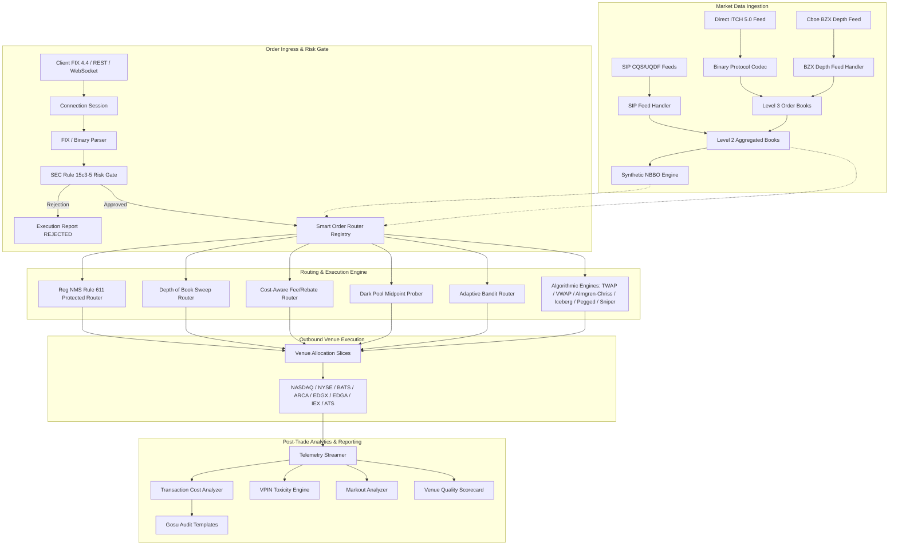
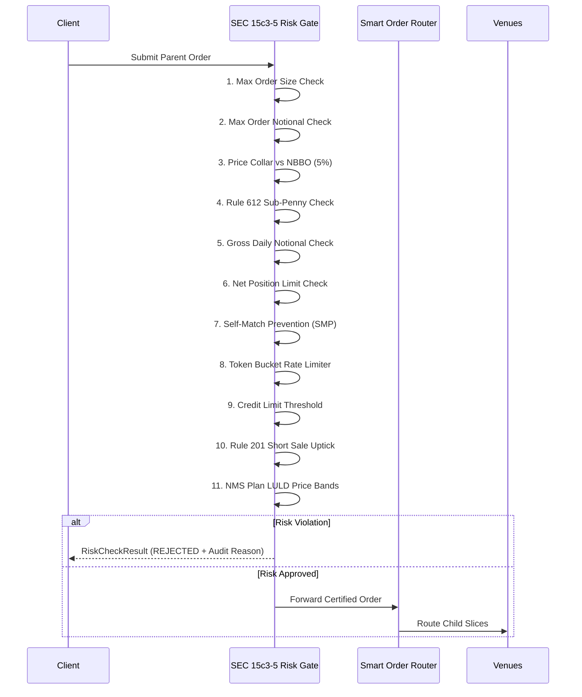

# Fairlead System Architecture

Fairlead is a deterministic, high-throughput Smart Order Router (SOR), multi-venue synthetic NBBO aggregator, SEC Rule 15c3-5 pre-trade risk engine, and optimal algorithmic execution system. It is implemented in Gosu, supported by Java NIO networking, off-heap ring buffers, C99 SIMD acceleration, and a Python client and terminal user interface.

## System Topology

The system is organized into modular architectural layers designed for sub-microsecond determinism, zero garbage collection pauses on hot routing paths, and rigorous regulatory compliance.

## Core Subsystems

### 1. Market Data & Synthetic NBBO Reconstruction

The National Best Bid and Offer (NBBO) is reconstructed dynamically in software across all active Reg NMS lit quotation centers.

- **Level 2 Limit Order Books (`OrderBookLevel2.gs`)**: Maintains sorted price ladders (`TreeMap<Long, PriceLevel>`) with reverse ordering on bids (highest bid first) and natural ordering on asks (lowest ask first). Provides microsecond-level ladder updates and depth queries.
- **Level 3 Order-by-Order Books (`OrderBookLevel3.gs`)**: Tracks discrete order life cycles and strict FIFO queue priority positions. Each price level maintains a `LinkedHashMap<String, RestingOrder>` to compute exact shares queued ahead of an order.
- **Synthetic NBBO Aggregator (`SyntheticNBBOEngine.gs`)**: Reconciles quotes from 10 distinct venues (NASDAQ, NYSE, BATS, ARCA, EDGX, EDGA, IEX, and ATS dark pools). Automatically resolves locked markets ($P_{\text{bid}} = P_{\text{ask}}$) and crossed markets ($P_{\text{bid}} > P_{\text{ask}}$), computes volume-weighted micro-prices, and detects sequence gap drops.

### 2. SEC Rule 15c3-5 Pre-Trade Risk Gate

Federal regulations mandate broker-dealers with market access to implement financial and regulatory risk controls that cannot be breached or bypassed.

Every check is fully deterministic, zero-allocation on passes, and generates audit trail records rendered via Gosu templates (`RiskGateAuditLog.gst`).

### 3. Smart Order Routing Engine

The routing pipeline supports six distinct routing policies coordinated by `SmartOrderRouterRegistry.gs`:

1. **Reg NMS Rule 611 Protected Quote Router (`RegNMSProtectedQuoteRouter.gs`)**: Strictly prevents trade-throughs of protected quotes. Dispatches Intermarket Sweep Orders (ISO) with `TimeInForce.IOC` to sweep matching top-of-book quotes across lit exchanges simultaneously.
2. **Depth of Book Sweep Router (`DepthOfBookSweepRouter.gs`)**: Sweeps through multiple price levels across all fragmented venues to satisfy large institutional parents with minimal market impact.
3. **Cost-Aware Fee/Rebate Router (`CostAwareRouter.gs`)**: Dynamically evaluates exchange maker-taker fee schedules (e.g. taking on inverted fee venues like EDGA for $+0.0018$/share rebates before taking on traditional venues at $+0.0030$/share fees).
4. **Dark Pool Midpoint Prober (`DarkPoolProbingRouter.gs`)**: Probes non-displayed ATS venues and dark pools at the exact NBBO midpoint with Minimum Acceptable Quantity (MAQ) constraints before routing to lit books.
5. **Adaptive Bandit Router (`AdaptiveRoutingEngine.gs`)**: Uses Bayesian Beta-Bernoulli Thompson Sampling to learn venue fill rates and adverse selection in real-time, dynamically steering flow to venues with the highest fill probabilities.
6. **Queue Position Estimator (`QueuePositionEstimator.gs`)**: Estimates queue wait times and logistic execution probabilities $P(\text{fill}) = \frac{1}{1 + e^{-k(Q_{\text{ahead}} - Q_{\text{threshold}})}}$ to optimize passive quote placement.

### 4. Algorithmic Execution Suite

Fairlead implements institutional-grade optimal execution schedules:

- **TWAP (`TWAPExecutionEngine.gs`)**: Time-Weighted Average Price execution dividing orders into discrete slices with Gaussian interval randomization to prevent statistical reverse-engineering.
- **VWAP (`VWAPExecutionEngine.gs`)**: Volume-Weighted Average Price execution utilizing an intraday polynomial U-shaped volume curve ($V(t) = a t^2 - b t + c$) to minimize market impact during high-volume open and close periods.
- **Almgren-Chriss Optimal Execution (`AlmgrenChrissExecutionEngine.gs`)**: Closed-form calculus of variations solution minimizing the risk-adjusted execution cost $E[x] + \lambda V[x]$:
  $$x_j = \frac{\sinh(\kappa (T - t_j))}{\sinh(\kappa T)} X$$
- **Iceberg Orders (`IcebergExecutionEngine.gs`)**: Displays only small visible peaks (e.g. 500 shares) while holding larger quantities in reserve, reloading with Gaussian size jitter upon each fill.
- **Pegged Orders (`PeggedOrderEngine.gs`)**: Dynamic pegged orders (Midpoint, Primary, and Market pegs) with discretionary offsets that continuously track changing NBBO prices.
- **Sniper Strategy (`SniperStrategy.gs`)**: Stealth liquidity-taking engine that passively listens until favorable price conditions occur, then fires instant IOC bursts across dark pools and lit books.
- **Pairs Trading Strategy (`PairTradingStrategy.gs`)**: Statistical arbitrage co-integration engine calculating real-time spread $Z$-scores to execute simultaneous hedged entries and mean-reversion exits.

### 5. High-Performance Bridge & Hardware Acceleration

To bridge Gosu with high-performance systems engineering, Fairlead includes:

- **Java NIO Reactor Server (`FairleadServer.java`)**: Non-blocking `Selector` multiplexer handling HTTP/1.1 REST endpoints and RFC 6455 WebSockets with SHA-1 key handshakes and frame parsing.
- **Off-Heap Ring Buffer (`OffHeapRingBuffer.java`)**: Single-producer single-consumer circular queue backed by `sun.misc.Unsafe` direct memory allocations. Employs 64-byte cache line padding to eliminate false sharing between cores.
- **C99 SIMD Kernels (`c_src/`)**: Hand-optimized vectorized memory scan (`simd_vector_scan.c`) for finding price levels and ITCH fast parsing (`itch_fast_parser.c`), paired with hardware-accelerated CRC-32C checksum verification (polynomial `0x82F63B78`, Castagnoli).
- **Python Client SDK & TUI (`python/`)**: Async-compatible client SDK with interactive ANSI terminal user interface (`fairlead.tui`) for live depth ladder visualization and algorithmic order control.

### 6. Analytics & Execution Telemetry

- **Transaction Cost Analysis (`TransactionCostAnalyzer.gs`)**: Computes Arrival Price Slippage, Perrault Implementation Shortfall, and Opportunity Cost for institutional parent orders.
- **Spread Metrics (`SpreadMetrics.gs`)**: Derives Effective Spread, Realized Spread ($t + 5\text{s}$), and Price Impact metrics.
- **Markout Analyzer (`MarkoutAnalyzer.gs`)**: Evaluates post-trade markout curves across five discrete time horizons (1ms, 10ms, 100ms, 1s, 5s) to measure adverse selection.
- **VPIN Toxicity Engine (`OrderFlowToxicityAnalyzer.gs`)**: Volume-Synchronized Probability of Toxicity metric partitioning volume into constant buckets to detect informed toxic order flow in real-time.
- **Hawkes Process Event Model (`HawkesProcessEventModel.gs`)**: Univariate self-exciting point process simulation generating realistic clustered order book events via Ogata's modified thinning algorithm.
