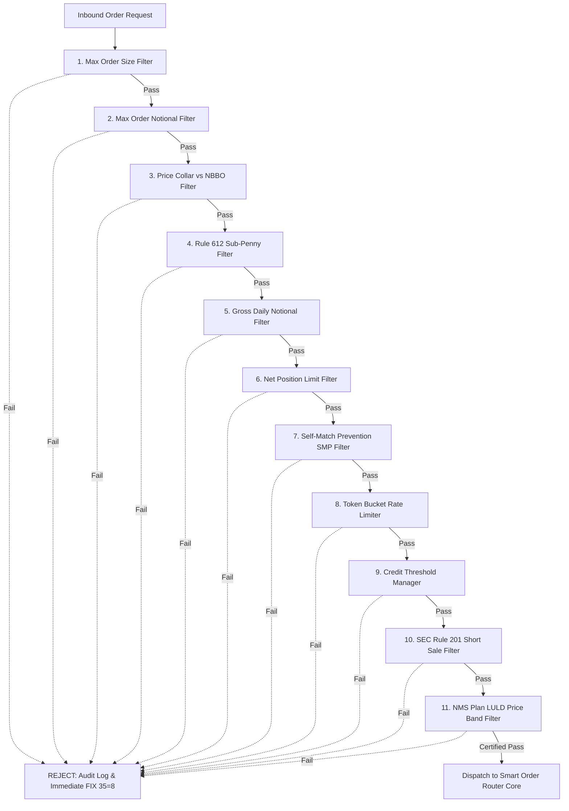

# SEC Rule 15c3-5: Market Access Pre-Trade Risk Architecture

## Regulatory Mandate & Background

On November 3, 2010, the Securities and Exchange Commission enacted **Rule 15c3-5** (17 CFR § 240.15c3-5) under the Securities Exchange Act of 1934, titled *"Risk Management Controls for Brokers or Dealers with Market Access"*.

Rule 15c3-5 prohibits broker-dealers from providing clients with "unfiltered" or "naked" access to an exchange or alternative trading system. Specifically, the rule mandates that broker-dealers must establish, document, and maintain a system of risk management controls and supervisory procedures reasonably designed to systematically manage the financial, regulatory, and legal risks of market access.

### Core Legal Requirements

1. **Pre-Trade Execution**: Risk controls must be applied automatically on a pre-trade basis before orders are routed to any execution venue. Post-trade reconciliation cannot substitute for pre-trade risk checks.
2. **Exclusivity of Control**: The controls must be under the direct and exclusive operational control of the broker-dealer. They cannot be delegated to an independent customer or third-party client.
3. **Immutability & Non-Bypassability**: The system architecture must prevent software routines, trading algorithms, or individual traders from circumventing or bypassing the risk gate.

Fairlead implements an institutional pre-trade risk engine in `RiskGate.gs` that validates every parent and child order against a customizable filter pipeline before allowing outbound transmission.

---

## Filter Pipeline & Risk Controls

### 1. Maximum Order Size Filter (`MaxOrderSizeFilter.gs`)
Validates that the gross share quantity of any single order does not exceed a hard risk threshold:

$$\text{Quantity} \le Q_{\text{max}}$$

Prevents "fat-finger" keystroke errors (e.g. entering 1,000,000 shares instead of 1,000 shares).

### 2. Maximum Order Notional Filter (`MaxOrderNotionalFilter.gs`)
Prevents orders whose total dollar notional exceeds capital allocation thresholds:

$$\text{Notional} = \text{Quantity} \times P_{\text{limit}} \le \mathcal{N}_{\text{max}}$$

### 3. Price Collar Filter (`PriceCollarFilter.gs`)
Protects against orders with limit prices straying excessively from the prevailing consolidated market. Compares order limit price against the National Best Bid or Offer:

For a **BUY** order:
$$\frac{P_{\text{limit}} - P_{\text{NBBO Ask}}}{P_{\text{NBBO Ask}}} \le C_{\text{max}} \quad (\text{Default: } 5.0\%)$$

For a **SELL** order:
$$\frac{P_{\text{NBBO Bid}} - P_{\text{limit}}}{P_{\text{NBBO Bid}}} \le C_{\text{max}} \quad (\text{Default: } 5.0\%)$$

Any aggressive limit order exceeding the collar percentage is rejected before crossing the book.

### 4. Rule 612 Sub-Penny Filter
Verifies minimum price variations. Any order on a stock priced >= $1.00 whose limit price contains fractions of a cent (e.g. $180.005) is rejected immediately.

### 5. Gross Daily Notional Filter (`GrossDailyNotionalFilter.gs`)
Tracks cumulative gross traded and open notional across all symbols for an account:

$$\sum |P_i \times Q_i| \le \mathcal{N}_{\text{daily\_limit}}$$

### 6. Net Position Limit Filter (`NetPositionFilter.gs`)
Maintains real-time inventory tracking per symbol to prevent portfolio concentration risk:

$$-\text{Pos}_{\text{max}} \le \text{CurrentPosition} + \text{SignedOrderQuantity} \le \text{Pos}_{\text{max}}$$

### 7. Self-Match Prevention Filter (`SelfMatchPreventionFilter.gs`)
Prevents wash-trading, internal self-crosses, and manipulative volume inflation under Section 9(a)(1) of the Exchange Act. Tracks all active resting orders per account, symbol, and price level.

Supported SMP Policies:
- **CANCEL_NEW**: Rejects the incoming aggressive order if an opposing resting order exists at that price level.
- **CANCEL_OLD**: Cancels the resting passive order and allows the incoming order to enter the market.
- **DECREMENT_AND_CANCEL**: Reduces both orders by the overlapping quantity; cancels the fully matched slice.

### 8. Order Rate Limiter (`OrderRateLimiter.gs`)
Token bucket rate limiter preventing algorithmic runaway loops ("infinite loop" quote flooding). Rejects orders when submission rates exceed tokens per second (e.g. 5,000 msgs/sec).

### 9. Credit Threshold Manager (`CreditThresholdManager.gs`)
Tracks real-time buying power utilization across multiple accounts. Rejects orders when margin headroom is exhausted.

### 10. SEC Rule 201 Short Sale Circuit Breaker (`ShortSaleCircuitBreakerFilter.gs`)
Enforces the SEC Alternative Uptick Rule when triggered (symbol declines >= 10% from prior close). Rejects any short sale order priced at or below the National Best Bid unless marked as exempt (`Side.SELL_SHORT_EXEMPT`).

### 11. NMS Plan Limit-Up / Limit-Down Filter (`LimitUpLimitDownFilter.gs`)
Validates that buy orders do not exceed Upper Price Bands, and sell orders do not fall below Lower Price Bands established by the National Market System Plan to Address Extraordinary Market Volatility.

---

## Audit Trail & Compliance Reporting

Rule 15c3-5 requires audit trails of all risk checks. In Fairlead, every validation event is recorded with:
- Order reference identifier (`OrderId`, `ClOrdId`)
- Account identifier and Trader ID
- Timestamp accurate to the nanosecond
- Number of risk filters evaluated
- Individual pass/fail status and violation diagnostics
- Rendered audit log via Gosu template (`RiskGateAuditLog.gst`)
